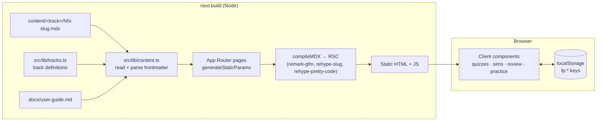

# Architecture

How First Principles is built: the stack, how content becomes pages, where learner state lives, and how the UI is organized.

## At a glance

- **Next.js 16 App Router**, fully **statically generated**. Every route is pre-rendered at build time; there is no runtime server logic, database or API.
- **Content** is MDX files under `content/`, read from disk at build time and compiled with `next-mdx-remote` (React Server Components).
- **Interactivity** (quizzes, simulators, progress, review) lives in client components.
- **Learner state** is kept in `localStorage` through a small store abstraction, read with `useSyncExternalStore`.
- **Styling** uses Tailwind CSS v4 with the Typography plugin, a brand color token, and a small set of shared UI primitives.



## Tech stack

| Layer | Choice | Notes |
|---|---|---|
| Framework | Next.js 16.4 (App Router, Turbopack) | Static generation only; `dynamicParams = false` on dynamic routes |
| UI | React 19.3, TypeScript 5 | Server components by default; `"use client"` only where needed |
| Content | MDX via `next-mdx-remote/rsc` | `remark-gfm` (tables), `rehype-slug` (heading ids), `rehype-pretty-code` + Shiki (dual light/dark code themes) |
| Styling | Tailwind CSS v4, `@tailwindcss/typography` | Configured in CSS (`src/app/globals.css`), wired through Turbopack in `next.config.ts` |
| Fonts | Geist Sans / Geist Mono via `next/font` | |
| Headings | `github-slugger` | Produces the same ids as `rehype-slug`, for the "On this page" outline |

## Directory layout

```
content/                  Lessons: content/<track-slug>/NN-lesson-slug.mdx
docs/                     Project documentation (user-guide.md is also rendered at /guide)
src/
  app/                    Routes (App Router)
    layout.tsx            Header, footer, theme script, search index
    page.tsx              Home: hero + roadmap
    tracks/[track]/       Track page
    tracks/[track]/[lesson]/  Lesson page
    review/ practice/ progress/ guide/
    globals.css           Tailwind setup, brand tokens, prose and code styling
  components/
    ui.tsx                Shared primitives: Button, Card, Badge, ProgressBar/Ring, Segmented, …
    mdx.tsx               MDX compile + the component map lessons can use
    lesson/               Lesson building blocks: Problem, MentalModel, Quiz, Scenario, Flow, …
    sims/                 Interactive simulators (registered in sims/index.ts)
    site/                 App chrome and features: Nav, SearchBox, ReviewDeck, Practice, ProgressDashboard, …
  lib/
    tracks.ts             Track and stage definitions (the roadmap)
    content.ts            Build-time content access: lessons, headings, takeaways, quizzes, docs
    store.ts              localStorage store factory, day numbers, activity log
    progress.ts           Lesson completions
    srs.ts                Spaced-repetition scheduling
    quizStats.ts          Per-question quiz history
    backup.ts             Export / import / reset of all learner data
```

## Routes

| Route | Rendering | What it does |
|---|---|---|
| `/` | Static | Hero, continue-learning card, roadmap of stages and tracks |
| `/tracks/[track]` | SSG (one per track with lessons) | Track overview and lesson list |
| `/tracks/[track]/[lesson]` | SSG (131 pages) | Lesson: sidebar, MDX content, outline, completion |
| `/review` | Static | Spaced-repetition session and browse mode |
| `/practice` | Static | Cross-course quiz sessions |
| `/progress` | Static (client-rendered body) | Stats, heatmap, per-track table, backup |
| `/guide` | Static | Renders `docs/user-guide.md` |

Dynamic routes set `dynamicParams = false`, so any path not produced by `generateStaticParams` returns 404.

## The content pipeline

All content access lives in `src/lib/content.ts` and runs at **build time only** (it uses `node:fs`).

1. **Discovery.** `getLessons(track)` lists `content/<track>/*.mdx`. The `NN-` filename prefix sets the order, and the rest of the filename is the URL slug.
2. **Frontmatter.** A minimal parser reads flat `key: value` pairs (`title`, `description`, `minutes`, `level`, `section`).
3. **Rendering.** The lesson page passes the body to `renderLesson()` in `src/components/mdx.tsx`, which calls `compileMDX` with the component map. `blockJS: false` is set because lessons are trusted, first-party content that pass arrays and objects as props.
4. **Derived data**, also extracted at build time:
   - `getHeadings(body)` returns the `##`/`###` headings outside code fences, slugged with `github-slugger`, for the outline.
   - `getTakeaways(track, slug)` returns the bullets inside `<KeyTakeaways>`, which become review cards.
   - `getQuizzes(track, slug)` parses every `<Quiz … />` element's JSX attributes into data for the Practice page and per-track accuracy. Attribute expressions are evaluated, which is safe only because the content is trusted.
   - `getDoc(name)` returns a markdown file from `docs/`.

The search index (title, description and track for every lesson) is built in the root layout and passed to the client `SearchBox`, so search is instant and needs no network.

## Learner state

There is no backend; everything a learner does is persisted in `localStorage` under keys prefixed with `fp:`.

| Key | Module | Shape |
|---|---|---|
| `fp:progress:v2` | `lib/progress.ts` | `{ "<track>/<slug>": completedAtMs }`. Migrates automatically from the v1 array format. |
| `fp:srs:v1` | `lib/srs.ts` | `{ "<track>/<slug>": { due, interval, ease, reps, lapses } }` |
| `fp:quiz:v1` | `lib/quizStats.ts` | `{ "<question text>": { seen, correct, lastCorrect, at } }` |
| `fp:activity:v1` | `lib/store.ts` | `{ <dayNumber>: eventCount }`, for streaks and the heatmap |
| `fp:self-assessment:v1` | `sims/SelfAssessment.tsx` | Competency ratings and target level |
| `fp:theme` | `layout.tsx`, `site/client.tsx` | `"light"` or `"dark"` |

### The store pattern

`createStore(key, fallback, migrate?)` in `lib/store.ts` returns `{ get, set, reload, useValue }`:

- An **in-memory cache** keeps snapshots referentially stable, which `useSyncExternalStore` requires.
- **Cross-tab sync** comes from listening to `storage` events.
- `useValue()` uses `useSyncExternalStore` with the fallback as the **server snapshot**. Static HTML therefore renders the "empty" state, and the client re-renders with real data after hydration, without hydration mismatches.
- Writes that represent learning (completing a lesson, answering a quiz, rating a review card) also call `logActivity()`.

Day-based logic (due dates, streaks, the heatmap) uses `dayNumber()`, the learner's *local* calendar day as an integer. Components that render dates (the progress dashboard) render only after mount, because the server can't know the viewer's clock.

### Spaced repetition

`lib/srs.ts` implements a simplified SM-2:

- New cards start with ease 2.5.
- **Good**: intervals of 1 day, then 3 days, then `interval × ease`.
- **Easy**: a longer interval, and ease rises by 0.15.
- **Hard**: `interval × 1.2`, and ease falls by 0.15.
- **Forgot**: the card resets, is due today and goes back into the current session. Ease falls by 0.2, with a floor of 1.3.

`dueQueue()` returns scheduled cards that are due plus completed lessons that have never been reviewed ("new"). The review UI snapshots this queue when a session starts and caps new cards at 10 per session.

### Backup

`lib/backup.ts` exports every `fp:*` key as a versioned JSON file. Restore validates the format, replaces all `fp:*` keys and reloads the page. Reset clears everything except the theme.

## UI architecture

### Server vs client components

Pages and layouts are **server components**. They read content and pass plain data down. Interactive pieces are small client components:

- `site/client.tsx`: theme toggle, completion button, track progress and status, lesson links and rows, due badge.
- `site/Nav.tsx`: active-route nav links and the mobile menu (`usePathname`).
- `site/SearchBox.tsx`, `site/OnThisPage.tsx` (scroll-spy and reading bar).
- `site/ReviewDeck.tsx`, `site/Practice.tsx`, `site/ProgressDashboard.tsx`.
- `lesson/Quiz.tsx`, `lesson/Scenario.tsx`, and every simulator in `sims/`.

### Design system

- **Tokens.** `globals.css` defines a `brand` color ramp (currently aliased to indigo) in `@theme`. Changing those eleven lines rebrands the app. Emerald is reserved for completion and correct answers, and rose for wrong answers.
- **Primitives.** `components/ui.tsx` provides `Button`/`ButtonLink`/`buttonClass`, `Card`, `Badge`, `LevelBadge`, `Eyebrow`, `PageHeader`, `Kbd`, `ProgressBar`, `ProgressRing`, `StatTile` and `Segmented`. New UI should compose these, not repeat long class strings.
- **Dark mode** is class-based (`.dark` on `<html>`). An inline script in the layout applies the saved or system theme before first paint to avoid a flash.
- **Lesson typography** comes from Tailwind Typography (`prose`). Callout blocks (`Problem`, `MentalModel`, …) deliberately stay *inside* the prose scope so lists and links in them keep their styling. Self-contained widgets (`Quiz`, `Tradeoffs`, simulators) opt out with `not-prose`.
- **Accessibility.** There is a skip link, one global `:focus-visible` outline, `aria-current` on active nav and lesson links, labelled progress bars, and keyboard shortcuts for every repeated action.

## Build and run

```bash
npm install
npm run dev     # http://localhost:3000
npm run build   # pre-renders every page (≈150)
npm run start   # serve the production build
npm run lint
npm run check:links   # every external link in content/ and docs/ (needs network)
```

The output is static, so any host that serves a Next.js build works: Vercel, a container running `next start`, or a CDN.

### GitHub Pages

`.github/workflows/deploy-pages.yml` deploys every push to `main`. It builds with `STATIC_EXPORT=true`, which switches `next.config.ts` to `output: "export"` (plain HTML in `out/`, trailing slashes), and with `BASE_PATH=/<repo-name>`, because a project site is served from `https://<owner>.github.io/<repo-name>/`. To try the same build locally:

```bash
STATIC_EXPORT=true BASE_PATH=/first-principles npm run build
```

One-time setup: in the repository, go to **Settings → Pages** and set **Source** to **GitHub Actions**.

Internal links must go through `next/link` (lessons get this automatically, because `a` is mapped in `src/components/mdx.tsx`). A raw `<a href="/…">` would miss the base path.

## Extending

| To add… | Do this |
|---|---|
| A lesson | Add `content/<track>/NN-slug.mdx` (see [authoring.md](authoring.md)) |
| A track | Add it to `src/lib/tracks.ts` and create `content/<slug>/` |
| A lesson building block | Create it in `src/components/lesson/` and add it to the map in `src/components/mdx.tsx` |
| A simulator | Create it in `src/components/sims/`, wrap it in `SimFrame`, export it from `sims/index.ts` |
| A new kind of learner data | Use `createStore` with a new `fp:<name>:v1` key, and add its `reload` to `lib/backup.ts` |
